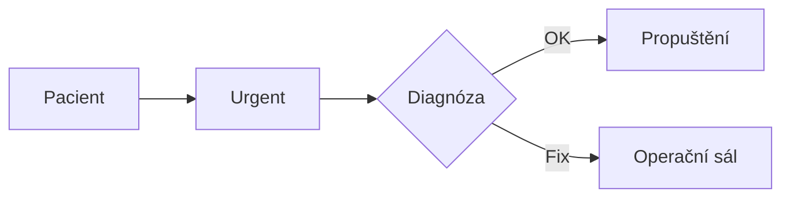

# Phase 2 — Mermaid-like diagrams, 100% VanillaJS

## Goal

Allow a **small, explicit subset** of Mermaid-like text inside fenced `mermaid` blocks, without importing Mermaid, rendering user-controlled HTML, using `eval`, downloading fonts/assets, or executing text as JavaScript.

A working first example should be:

````markdown

````

## Parser model

1. **Lexical scope:** allow only `flowchart LR|RL|TB|TD|BT` in milestone D1. Support `sequenceDiagram` in optional D2. Reject everything else with a **visible escaped source fallback**, rather than trying to infer semantics.
2. **Nodes:** `A[Text]` (rectangle), `B(Text)` (rounded), `C{Text}` (diamond); IDs restricted to `[A-Za-z][A-Za-z0-9_]{0,31}`, labels length ≤120 characters. Plain `A` is allowed if previously defined. Keep IDs separate from labels.
3. **Edges:** `A --> B`, `A --- B`, `A -- yes --> B` for directional/undirected edges with plain labels. At most 150 nodes / 250 edges; max 12 KiB per diagram; no special directives, `click`, URL links, style attributes or class definitions.
4. **IR:** immutable-ish `{direction,nodes:[{id,label,shape}],edges:[{from,to,label,kind}]}`. Validate all IDs and referenced nodes before any rendering.
5. **Layout:** deterministic layered DAG layout (Kahn ranking; rank groups; stable ordering; bounding boxes from native font metrics when possible, conservative fallback offline). For graph cycles, render a harmless explanatory fallback or deliberately supported back edges. No unbounded force simulation.
6. **Renderer:** use `document.createElementNS('http://www.w3.org/2000/svg', ...)`, `textContent` for labels, numeric `setAttribute` for coordinates, only known SVG primitives (`svg`, `g`, `rect`, `path`, `polygon`, `line`, `text`, `marker`). **No `foreignObject`, no raw SVG `innerHTML`, no event handler attributes, no external resources.**
7. **Integration:** current `MD.js` parses Markdown to HTML strings. In D1, separate a diagram hydration step (e.g., `md.mount(container, text)`) that recognizes fenced diagrams through an internal typed token, creates SVG DOM nodes safely, and inserts ordinary Markdown via the renderer. Avoid interpolating source text into `data-*` or attributes to transfer diagram payloads. Preserve `md.parse(text)` as **HTML-only safe fallback** for backward compatibility.

## Test priorities

- Correct graph grammar (rectangles, diamonds, rounded nodes, directional edges, labels, LR/TB).
- Duplicate IDs, missing declarations, invalid grammar, cycles, disconnected subgraphs, empty labels, very long Unicode labels and emoji.
- Injection probes: `<script>`, `</svg>`, `onload`, `foreignObject`, `javascript:`, HTML character references, zero-width/control characters, quotes and angle brackets in labels.
- Fuzz random UTF-8/Unicode text, thousand-node abuse attempts, pathological cycles and long-edge labels.
- Visual regression at multiple viewport widths and with different fonts. Accessibility: `<title>` + `<desc>` in SVG, keyboard-accessible fallback source.
- Performance limit: ≤150 nodes, ≤250 edges, bounded layout passes and no layout forced repeatedly per node.

## No false promises

A safe renderer can bound the parsing/DOM attack surface, but *"unbreakable"* is not a verifiable security property. Security acceptance requires tests with browser DOM APIs, automated fuzzing, and a review of the SVG/URL/CSP handling. Full Mermaid compatibility is **explicitly out of scope**.
