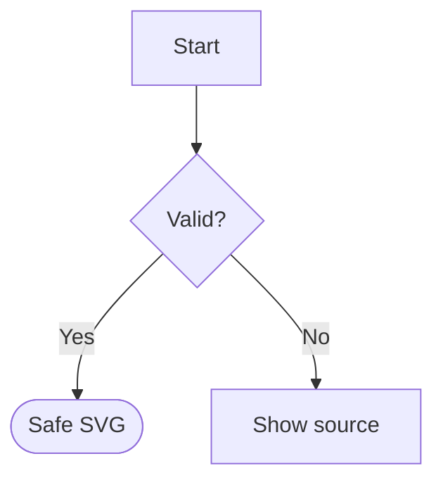

# MD.js Reborn v0.3 — Arctic Edition

**Phases 2 + 3 delivered.** The 2016 Markdown parser rebuilt as browser-native ES6, now with a strict Mermaid-like SVG renderer and complete document light/dark/readability controls.

No packages, imports, CDNs, fonts, `eval`, `Function`, `foreignObject`, external diagram code, or network requests are needed to render the Markdown and its diagrams. The supplied `MD.js` can still be used standalone as an HTML renderer.

## Open the demo

Open `examples/index.html` directly in a browser. Type Markdown on the left; see the entire document on the right. Its embedded toolbar controls the document's theme, text scale (80–160%), reading width, and heading outline. Each diagram has independent zoom/reset/source controls.

To embed in your own page:

```html
<link rel="stylesheet" href="MD.css">
<article class="md-root" id="article"></article>
<script src="MD.js"></script>
<script src="MD-diagrams.js"></script>
<script src="MD-UX.js"></script>
<script>
  const md = new MD({ mode: 'extended' });
  md.mount(document.getElementById('article'), `# Hello\n\n\`\`\`mermaid\nflowchart LR\n A[Start] --> B[Done]\n\`\`\``);
</script>
```

**No JavaScript module `import` is used.** The three small scripts are classic browser scripts. You can embed all code into one local HTML file if desired; split source files are only for maintainability.

**Backward compatibility:** `new MD({mode:'extended'}).parse(text)` still returns a safe HTML string. Diagram fences remain syntax-highlight-free, escaped `<pre><code>` blocks in `parse()` alone. `mount(container, text)` hydrates those code blocks into safe SVG if `MD-diagrams.js` is loaded. If it is not loaded, the code remains visible. `MD-UX.js` is optional too. Reader preferences persist *within the same container across rerenders*, not across browser sessions; nothing is stored in localStorage/cookies.

## F2 — strictly limited Mermaid-like source grammar

The supported subset deliberately **does not** claim general Mermaid compatibility.

| Diagram | Supported | Deliberate limitation |
|---|---|---|
| `flowchart` / `graph` | `LR`, `RL`, `TB`/`TD`, `BT`; rectangles, rounded, diamonds, circles, stadium-like; chained arrows, dashed, heavy, unlinked, edge labels; one-level `subgraph` | No arbitrary CSS/classes, links, `click`, complex edge IDs |
| `sequenceDiagram` | `actor`/`participant`, `as`, `->>`, `-->>`, `->`, `-->`, `Note over`, `activate`/`deactivate` | No nested `alt`, `opt`, `loop` fragments |
| `stateDiagram-v2` | Start/end `[*]`, named states, labeled transitions | No nested states, descriptions or concurrency |
| `classDiagram` | Classes, member entries, basic inheritance/association arrows | No nested generics, UML constraints, annotations or Mermaid styling |
| `timeline` | Title, sections, events by date, extra items at the same date | No advanced grouping, dates are display labels only |
| `pie` / `pie showData` | `title`, positive numeric slices, auto-percentage legend | Max 16 slices; no arbitrary style directives |

Example flowchart:

````text

````

### Security boundaries

The diagram engine is a narrow lexer/parser producing a constrained intermediate representation, not a generic Mermaid interpreter. Bounds: **12 KiB/source, 260 statements, 120 graph nodes, 200 graph edges, 16 sequence participants, 120 sequence steps, 16 pie slices**. Each input must match the allowlist exactly; unknown constructs become visibly escaped source text. 

Rendering uses **only** DOM-created SVG tags with `document.createElementNS`, with labels assigned using `textContent`, coordinates computed numerically, and colors assigned through static CSS variables. No arbitrary node HTML, CSS from Markdown, event handlers, SVG URLs, `foreignObject`, scripts, external images, or browser network resources. Diagram source is taken from `code.textContent`, never from interpolated HTML attributes. Existing Markdown links and images retain the parser's separate URL restrictions, and external HTTP images (if included by the user) can still make network requests.

This is a **defense-in-depth** implementation, not a mathematically proven impenetrable renderer. Treat a production deployment as security-sensitive: apply CSP, run an independent audit, fuzz across browser engines, and evaluate the embedding application's policies. JS extension callbacks remain trusted code, not sandboxes.

### Layout limits

A deterministic layered layout is used; cycles render with bounded fallback ranks rather than performing an unbounded physics simulation. The intention is understandable small diagrams, not faithful or pixel-identical Mermaid layout. Complex subgraphs/large cyclic graphs can visually overlap; invalid syntax never silently runs. SVG is horizontally scrollable with zoom controls.

## F3 — modern max UX

- **Light / dark theme across the entire rendered document** (including HTML tables, inline code, blockquotes, code highlighting and diagram palette).
- **A− / A+ / reset** for scalable Markdown typography.
- **Comfortable / wide reading mode** and accessible, collapsible H1–H3 document outline.
- **Each Mermaid SVG** has zoom in/out/reset and escaped-source toggle.
- Keyboard-operable buttons, `aria-label`, visible focus ring, reduced-motion setting, responsive panels, scoped styles.
- All colors controlled via `--md-*` CSS custom properties scoped to the `.md-root` container.

## Test and development

```bash
node --test test/*.test.js
node test/performance.js
# optional: open examples/integration-smoke.html in a local browser
```

No `npm install` needed. There are **117 passing Node tests** at the time of packaging: the 76 Phase-1 regressions and 41 additional diagrams/security/property tests. The DOM-backed browser integration smoke file is included but headless Chromium timed out in the artifact environment, so **cross-browser integration is not certified**. The Node suite uses a minimal mock SVG DOM for the renderer; it does not replace browser security tests.

## Original files and licensing

The exact three source artifacts uploaded from the 2016 project are retained under `legacy/`. Historical header claims GPLv3 while the repository previously advertised MIT; **resolve this with the author** before publishing the derivative under an explicit license. No license is silently assigned here.

## Planned next steps

Read [`ROADMAP-F4-F5.md`](ROADMAP-F4-F5.md). F4 is a measured research phase for extended Markdown interoperability (not an automatic feature dump). F5 is a separable **micro-IDE + virtual machine + assembler tooling + possible ZX Spectrum emulator**, not code to mix into the Markdown parser itself.
